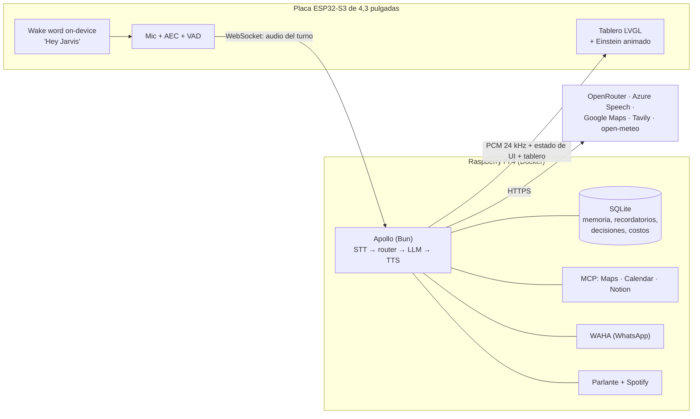

# Jarvis — asistente de voz de escritorio sobre ESP32 + Raspberry Pi

Un asistente de voz tipo Jarvis que vive en una pantalla táctil de 4,3" (ESP32-S3) y piensa en
una Raspberry Pi de la casa. Le hablás ("Hey Jarvis"), te contesta en español rioplatense, y
además te busca él a vos: te avisa a qué hora salir para llegar con el tráfico real, te recuerda
vencimientos que le llegan por mail, te muestra la agenda y los pendientes en un tablero, y si
no le prestás atención a un aviso, te lo manda por WhatsApp.

**Está basado en [Apollo](https://github.com/galfrevn/apollo)** de Valentín Galfre (servidor) y
en [apollo-firmware](https://github.com/galfrevn/apollo-firmware) (firmware, un fork de
[xiaozhi-esp32](https://github.com/78/xiaozhi-esp32)). Este repo no es un fork: es un
**overlay** — los archivos nuevos y los de upstream modificados, con la misma ruta que en
upstream — más los scripts que los aplican sobre un commit fijo de cada repo. Así se ve
exactamente qué se cambió y se puede seguir upstream.

```
"Hey Jarvis, el jueves a las 7 tengo turno con el dentista en Belgrano"
   → calcula el viaje con el tráfico de ese jueves a esa hora (no el de ahora),
     lo recalcula una hora antes, y te avisa 7 minutos antes de la hora de salir.
```

## Qué hay acá

| Carpeta | Qué es |
|---|---|
| [`server/`](server/) | Overlay sobre Apollo (rama `feat/node-host`, el host en Bun que corre en Docker). Toda la lógica de Jarvis. |
| [`firmware/`](firmware/) | Overlay sobre apollo-firmware: port a la Waveshare ESP32-S3-Touch-LCD-4.3C, tablero LVGL con una mascota animada, wake word "Hey Jarvis", guardianes. |
| [`infra/`](infra/) | Lo que corre en la Pi además de Apollo: servidores MCP (Maps, Calendar, Notion), WhatsApp (WAHA), parlante externo + Spotify, guardianes de disco y WiFi, tracking de costos. |
| [`scripts/`](scripts/) | Secretos en el Llavero de macOS, deploy, detector de fugas. |
| [`tools/`](tools/) | Simulador de la placa (conversar por texto sin hardware), cambio de voz, benchmarks. |
| [`docs/`](docs/) | [Arquitectura](docs/arquitectura.md) · [Customizaciones](docs/customizaciones.md) · [Secretos](docs/secretos.md) · [Lecciones y trampas](docs/lecciones.md) |

## Arquitectura en 30 segundos



La placa solo escucha, muestra y reproduce. Todo lo demás pasa en la Pi: transcripción
(Whisper vía OpenRouter), un **router de intenciones** que decide qué herramientas ve el modelo,
el LLM (DeepSeek vía OpenRouter), la voz (Azure con acento argentino, Piper local de respaldo),
la memoria y los avisos programados. Detalle en [docs/arquitectura.md](docs/arquitectura.md).

## Lo que se le agregó a Apollo

Lo principal (la lista completa, con el porqué de cada cosa, en
[docs/customizaciones.md](docs/customizaciones.md)):

- **"¿A qué hora salgo?"** — Decís "voy al dentista a las 3" y calcula el viaje con
  Google Maps **con tráfico a la hora de salida**, no el de ahora. Si falta más de una hora,
  recalcula una hora antes (el tráfico envejece) y te avisa 7 minutos antes de salir.
- **Router de intenciones** — Antes del LLM, un modelo chico (Jev) clasifica la frase en una
  llamada: intención, si es ruido de Whisper, si es una queja, si hace falta razonar y con qué
  personaje contestar. El LLM ve 10 herramientas en vez de 40 y no razona cuando no hace falta.
  Aprende solo cada noche de sus aciertos y errores.
- **Tablero en vez de cara** — La pantalla es un dashboard LVGL: hora, clima, agenda del día
  (calendario + recordatorios), pendientes, tiempo de viaje, y un Einstein pixel art que
  escucha, piensa, festeja o se va a pasear según el momento.
- **Voz argentina** — Azure `es-AR-TomasNeural` (4x más rápido que Piper en la Pi), con Piper
  local como red de seguridad si Azure falla.
- **Recordatorios en serio** — hasta 60 días, recurrentes ("todos los 5 a las 10"), con alarma
  y pantalla completa, que no te hablan encima mientras conversás, y que **te llegan por
  WhatsApp** si la placa está desconectada o si nadie los vio en 10 minutos.
- **Mensajes a otras personas** — "Decile a Ana que llego tarde" arma el borrador, te lo lee
  y solo lo manda si contestás "sí" en el turno siguiente. Lista cerrada de contactos, en código.
- **Vencimientos por mail** — Lee de Gmail solo los mails cuyo asunto habla de vencer o
  renovar, extrae concepto, fecha y monto, y te avisa el día anterior y el mismo día.
- **"No confirmes lo que no hiciste"** — Si el modelo dice "listo, te aviso" sin haber
  programado nada, o contesta un dato sin consultarlo, se lo frena y se repite la ronda
  obligándolo a usar la herramienta.
- **Listas espejadas en Notion** — Dictás pendientes y aparecen en una base de Notion; los
  tildás o editás en Notion y Jarvis se entera.
- **Parlante externo + Spotify** — La Pi es un dispositivo Spotify Connect; cuando Jarvis
  habla o escucha, la música baja sola.
- **Placa que no se cuelga** — Guardianes en el firmware (loop bloqueado, estados trabados,
  sin WiFi), OTA con rollback, informe de cuelgue al servidor en el próximo arranque.

## Cómo hacerlo funcionar

### Lo que necesitás

- **Placa:** Waveshare **ESP32-S3-Touch-LCD-4.3C** (800×480, touch GT911, 2 códecs con 4
  micrófonos, 16 MB flash, 8 MB PSRAM). Otra placa de xiaozhi-esp32 se puede portar, pero
  este overlay es para esta.
- **Servidor:** Raspberry Pi 4 (2 GB alcanza: el sistema entero con Apollo usa ~360 MB) con Raspberry Pi OS 64-bit
  y Docker. Fuente de **5 V / 3 A** (con un cargador de celular la Pi baja la CPU a 600 MHz).
- **Mac** con ESP-IDF 5.5.2 para compilar el firmware (los scripts de secretos usan el
  Llavero de macOS).
- **Cuentas:** [OpenRouter](https://openrouter.ai) (obligatoria: LLM, STT, embeddings y
  router con una sola key; unos USD 5 de crédito alcanzan para meses). Opcionales: Azure
  Speech (voz argentina, free tier), Google Cloud (Maps y Calendar), Tavily (búsqueda web),
  Notion, Gmail.

### 1. Preparar el repo y los secretos (en la Mac)

```bash
git clone <este repo> jarvis-apollo && cd jarvis-apollo
git config core.hooksPath .githooks          # frena commits con secretos adentro
cp jarvis.env.example jarvis.env             # IP de la Pi, URL del servidor (no secretos)
cp server/config.env.example server/config.env

scripts/secrets.sh generate DEVICE_SHARED_SECRET
scripts/secrets.sh generate DASHBOARD_SHARED_SECRET
scripts/secrets.sh set OPENROUTER_API_KEY     # te lo pide oculto
scripts/secrets.sh status                     # qué falta (nunca muestra valores)
```

Todos los secretos (y tus datos personales: dirección, teléfonos, mail) viven en el **Llavero
de macOS** y viajan a la Pi por ssh sin tocar el disco de la Mac. Ver
[docs/secretos.md](docs/secretos.md).

### 2. Preparar la Pi

```bash
source jarvis.env
ssh-copy-id "$JARVIS_PI"                     # acceso por clave
ssh "$JARVIS_PI" 'curl -fsSL https://get.docker.com | sh && sudo usermod -aG docker $USER'
ssh "$JARVIS_PI" 'docker network create jarvis-mcp'
```

Reservá la IP de la Pi en el router (la placa la tiene compilada) y apagá el ahorro de
energía del WiFi si la Pi no va por cable. Para la voz local de respaldo, bajá
[Piper](https://github.com/rhasspy/piper/releases) (`piper_linux_aarch64`) a `~/piper/piper/` y la
voz `es_MX-ald-medium` a `~/piper/voices/` en la Pi (opcional si usás Azure).

### 3. Levantar el servidor

```bash
scripts/deploy-server.sh
# ✓ Apollo responde en http://<ip>:8799/health
```

Arma upstream + overlay en `.cache/apollo`, lo sube, genera el `.dev.vars` desde el Llavero y
reconstruye el contenedor.

**Probalo sin placa** con el simulador (se hace pasar por el ESP32):

```bash
source jarvis.env
bun tools/desk-simulator.ts --host "$JARVIS_APOLLO_HOST" --say "Hola, ¿quién sos?"
# el token lo saca del Llavero; guarda la respuesta hablada en jarvis-respuesta.wav
```

### 4. Compilar y flashear el firmware

```bash
# Una vez: ESP-IDF 5.5.2 en ~/esp/esp-idf (./install.sh esp32s3) y brew install cmake ninja

# ANTES de flashear por primera vez, backup de los 16 MB de fábrica:
esptool --port /dev/cu.usbmodem101 read-flash 0 0x1000000 backup-fabrica.bin

firmware/apply.sh                            # clona apollo-firmware 2.7.1 + overlay
firmware/build.sh ~/esp/jarvis-apollo-firmware flash
```

`build.sh` saca la URL de `jarvis.env` y el secreto del Llavero, los inyecta en el build y
borra el temporal (cada corrida recompila todo, ~5 min; para iterar sobre el código usá
`idf.py build` dentro del árbol). En el primer arranque la placa abre una red WiFi
`Xiaozhi-XXXX`: conectate desde el celular y cargale tu red de 2,4 GHz. Después,
"Hey Jarvis" (pronunciado en inglés).

### 5. Sumar integraciones (opcional)

Cada una es independiente; sin su key, la función simplemente no aparece.

| Integración | Qué hacer |
|---|---|
| Voz argentina | `scripts/secrets.sh set AZURE_SPEECH_KEY` y `TTS_PROVIDER=azure` en `server/config.env` |
| Viajes y "a qué hora salir" | Habilitá Distance Matrix, Directions, Geocoding y Places en Google Cloud; `secrets.sh set GOOGLE_MAPS_API_KEY` e `IDLE_TRAVEL_ORIGIN` (tu dirección) |
| Google Calendar / Notion / Maps por voz | Servidores MCP en [`infra/mcp-servers/`](infra/mcp-servers/) — ver [docs/arquitectura.md](docs/arquitectura.md#servidores-mcp) |
| WhatsApp | [`infra/whatsapp/`](infra/whatsapp/): WAHA con motor GOWS, se vincula escaneando un QR |
| Parlante + Spotify | [`infra/speaker/README.md`](infra/speaker/README.md) |
| Vencimientos por mail | Contraseña de aplicación de Gmail: `secrets.sh set GMAIL_USER` y `set GMAIL_APP_PASSWORD` |
| Fútbol, pádel | Interruptores en `server/config.env` (vienen apagados) |

Después de cargar secretos nuevos: `scripts/push-secrets.sh all --restart`.

## Cuánto cuesta

Centavos por mes para un uso personal: con las tarifas públicas de OpenRouter, un turno típico
(STT + router + LLM + embeddings) cuesta del orden de una décima de centavo de dólar. Azure
Speech entra en el free tier, y Maps y Calendar en el uso gratuito de Google para un solo
usuario (verificá los límites vigentes de tu cuenta). Para seguir tu propio gasto: cada llamada
guarda su costo exacto en la base (`api_costs`), y [`infra/costs/cost-tracker.py`](infra/costs/)
registra cada hora el consumo de tu key.

## Tests

```bash
server/apply.sh /tmp/apollo && cd /tmp/apollo && bun install
cd apps/agent && bun test
```

982 tests. Corriendo la suite entera de una vez fallan 2 tests de `local head` del router:
no es un bug de esa función sino timers del test del host (`src/host/`) que siguen vivos
después de que ese test cierra la base, y le caen al test que esté corriendo. Separados pasan
todos: `bun test src/host` y `bun test $(ls -d src/*/ | grep -v src/host/)`.

## Créditos y licencias

- [Apollo](https://github.com/galfrevn/apollo) — MIT, © 2026 Valentín Galfre ([`server/LICENSE.apollo`](server/LICENSE.apollo)).
- [apollo-firmware](https://github.com/galfrevn/apollo-firmware) / [xiaozhi-esp32](https://github.com/78/xiaozhi-esp32) — MIT ([`firmware/LICENSE.apollo-firmware`](firmware/LICENSE.apollo-firmware)).
- [esp-ml307](https://github.com/78/esp-ml307) — Apache 2.0, copia modificada en `firmware/overlay/components/esp-ml307/` (ver su `JARVIS.md`).
- Wake word: modelo `hey_jarvis` de [esphome/micro-wake-word-models](https://github.com/esphome/micro-wake-word-models).
- Mascota: sprite "Einstein" hecho con PicoPixel, convertido a LVGL con `tools/convert-einstein.sh`.
