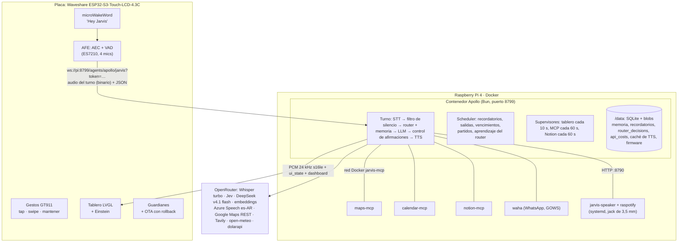

# Arquitectura

Tres piezas: una **placa** que escucha y muestra, un **servidor** en una Raspberry Pi que
piensa, y unos **servicios vecinos** en la misma Pi (MCP, WhatsApp, parlante). La placa no sabe
nada de LLMs; el servidor no sabe nada de pantallas. Se hablan por un WebSocket.



## La placa (firmware)

Base: `apollo-firmware` 2.7.1, que es un fork de `xiaozhi-esp32` con el protocolo de Apollo. Lo
que hace la placa:

- **Wake word en el dispositivo** con microWakeWord y el modelo oficial `hey_jarvis` de ESPHome
  (umbral 80 %: el 97 % del manifiesto no disparaba con voces reales). No sale audio de la
  casa hasta que alguien dice "Hey Jarvis" o mantiene el dedo en la pantalla.
- **Audio**: dos códecs (ES8311 de salida, ES7210 de entrada con 4 micrófonos en TDM), cancelación
  de eco por hardware + AFE de Espressif (modo `FD_LOW_COST`, que usa la mitad de RAM interna que
  el default de Apollo). El VAD corta el turno a los **850 ms** de silencio.
- **Protocolo** (`main/protocols/apollo_protocol.cc`): WebSocket a
  `ws://<servidor>/agents/apollo/<dispositivo>?token=<DEVICE_SHARED_SECRET>`. El audio del turno
  sube en frames binarios; la voz baja como **PCM crudo 24 kHz s16le mono**; todo lo demás es
  JSON (`hello`, `ui_state`, `dashboard`, `tts_start`/`tts_end`, `turn_end`, `reminder_seen`,
  `boot_report`).
- **Pantalla**: tablero LVGL (`main/display/jarvis_dashboard_display.cc`) que reemplaza al motor de
  caras de Apollo. Los datos los arma el servidor y los recorta él (cambiar un largo en
  TypeScript es gratis; en C es un reflasheo).
- **Gestos** (GT911): tap, doble tap, swipe, mantener para hablar. Corren en una tarea propia
  que lee el touch, también con el tablero LVGL.
- **Guardianes** (`main/application.cc`): latido del loop principal (90 s sin latido →
  reinicio), estados trabados (conectando > 60 s, escuchando > 120 s, hablando > 300 s → vuelve
  a reposo), y reinicio solo tras 20 min **sin WiFi** (sin servidor, reintenta en silencio con
  backoff 5–60 s). Un volcado de memoria en flash (`coredump`) viaja al servidor en el próximo
  arranque como `boot_report`.
- **OTA**: la placa consulta `/ota/check` al arrancar; la versión nueva arranca "pendiente" y se
  marca buena recién tras 60 s conectada (si no, el bootloader vuelve a la anterior).
- **Red**: copia de `esp-ml307` con timeouts en `connect()`/`send()` y keepalive (el original
  bloqueaba el loop sin límite), y búferes TCP de 32 KB en PSRAM.

## El servidor (Apollo en la Pi)

Apollo upstream está pensado para Cloudflare (Durable Objects, Vectorize, R2, Queues). La rama
`feat/node-host` trae un **host en Bun** con adaptadores locales: SQLite para todo, carpeta para
blobs, coseno por fuerza bruta para vectores, una tabla de jobs como cola. Corre en un solo
contenedor con un volumen (`/data`). En la Pi de 2 GB todo el sistema queda en ~360 MB.

### Un turno de punta a punta

1. **STT** — el audio va a Whisper (`openai/whisper-large-v3-turbo` por OpenRouter, 1–1,25 s).
2. **Filtro de silencio** (`voice/silence.ts`) — Whisper alucina con silencio ("Gracias", "Gracias
   por ver el video", "Subtítulos de Amara.org"). Se descartan antes del LLM; si no, el modo
   conversación contestaba solo.
3. **En paralelo**: la **memoria semántica** (embedding de la frase contra la memoria de largo
   plazo) y el **router** (`router/`). Comparten el mismo embedding.
4. **Router con Jev** — una llamada a un modelo chico que devuelve probabilidades para cinco
   preguntas: intención (17 opciones), ¿es ruido?, ¿es una queja del turno anterior?, ¿hay que
   razonar?, ¿qué personaje? Con eso elige un nivel:

   | nivel | cuándo | qué ve el LLM |
   |---|---|---|
   | `ignore` | ruido ≥ 0,88 | nada: ni LLM ni TTS |
   | `fast` | hora, charla, dólar con p ≥ 0,9 | 0 herramientas (el dólar se busca antes) |
   | `narrow` | p ≥ 0,7 | las herramientas de la intención + una de escape |
   | `full` | dudoso o Jev caído/lento (> 1,5 s) | todas, como Apollo original |

   Si al LLM le falta algo, llama a `usar_todas_las_herramientas` y la ronda siguiente tiene todas.
5. **LLM** — `deepseek/deepseek-v4.1-flash`, con `reasoning` apagado salvo que Jev diga que hace
   falta (razonar sumaba ~2 s por ronda).
6. **Control de afirmaciones** (`turn/claims.ts`) — si el pedido era de acción y el modelo
   confirma sin haber llamado a ninguna herramienta, o contesta un dato sin consultarlo, la
   respuesta no se dice: se repite la ronda con `tool_choice: required`.
7. **TTS** — Azure `es-AR-TomasNeural` en `brazilsouth` (la región más cercana medida desde
   Buenos Aires), en el formato exacto que reproduce la placa. Si falla, Piper local. Caché por
   texto y voz en `/data/blobs`. El primer segmento se sintetiza mientras el LLM todavía escribe.
8. **Salida** — la voz va a la placa o al parlante de la Pi (según `SPEAKER_ROUTE`), y la
   pantalla recibe primero lo que escuchó (entre comillas), después el texto escribiéndose en
   vivo y la frase que está diciendo, con el color del anillo según la familia de la
   herramienta (azul búsqueda, verde mapas, naranja agenda, violeta memoria…).

Cada turno deja una línea `apollo_turn_timings` con el tiempo de cada etapa y de cada
herramienta por nombre, y una fila en `router_decisions`. Turnos típicos: 2–4 s.

### Lo que corre solo (scheduler)

El principio: **lo que te tiene que buscar a vos es un cron, no una herramienta.** Una
herramienta MCP se paga en el prompt de cada turno; un cron que hace `fetch` no cuesta tokens.

| Tarea | Cuándo | Qué hace |
|---|---|---|
| Recordatorios | lo que se programe | Alarma + pantalla completa; se posterga mientras estás hablando; por WhatsApp si la placa está desconectada o nadie lo vio en 10 min |
| `recomputeDeparture` | 1 h antes de salir | Recalcula el viaje con tráfico y programa el aviso de salida |
| Aprendizaje del router | 04:00 | Etiqueta los turnos del día, ajusta umbrales por intención, entrena el clasificador local, ajusta el A/B de razonamiento |
| Vencimientos (Gmail) | 08:00 y 18:00 | IMAP, solo asuntos de vencimiento/deuda, extracción con el LLM, avisos |
| Partidos | diario (opcional) | ESPN, próximas 26 h, aviso antes del partido |
| Torneos | diario (opcional) | Torneos nuevos de Premier Padel |
| Tablero | cada 10 s | Clima, agenda, pendientes, viaje → placa (siempre, cambie o no: así una placa que se reinició no queda vacía) |
| Supervisor MCP | cada 60 s | Reconecta servidores MCP caídos |
| Sync Notion | cada 60 s y a los 2 s de un cambio | Reconcilia listas en las dos direcciones |

## Servidores MCP

Apollo instala servidores MCP **por URL**, y los de Google son stdio. Cada uno corre en su
contenedor en la red Docker `jarvis-mcp` ([`infra/mcp-servers/compose.yaml`](../infra/mcp-servers/compose.yaml)):

| Servidor | Cómo | URL para Apollo |
|---|---|---|
| Google Maps | `@modelcontextprotocol/server-google-maps` detrás de `supergateway` en modo `streamableHttp` | `http://maps-mcp:8000/sse` |
| Google Calendar | `@cocal/google-calendar-mcp` en HTTP nativo (30x más rápido que por supergateway) | `http://calendar-mcp:8000/sse` |
| Notion | `@notionhq/notion-mcp-server` con token de integración interna (sin OAuth) | `http://notion-mcp:8000/sse` |

Para levantarlos:

```bash
source jarvis.env
scp -r infra/mcp-servers "$JARVIS_PI:"
scripts/secrets.sh set GOOGLE_MAPS_API_KEY
scripts/secrets.sh set-file GOOGLE_OAUTH_CLIENT_JSON_B64 ~/Downloads/client_secret_xxx.json   # cliente "Desktop app"
scripts/push-secrets.sh mcp && scripts/push-secrets.sh google
ssh "$JARVIS_PI" 'cd mcp-servers && docker compose up -d'
# Autorizar Calendar (abre el navegador en la Mac por un túnel):
ssh -t -L 3500:127.0.0.1:3500 "$JARVIS_PI" 'bash ~/mcp-servers/reauth-calendar.sh'
```

Y darlos de alta en Apollo desde la **consola de administración** de upstream
(`cd .cache/apollo/apps/console && bun run dev`, conectándola a `http://<ip-de-la-pi>:8799` con
el `DASHBOARD_SHARED_SECRET`): sección MCP → instalar con la URL de la tabla → habilitar **solo
las herramientas que vas a pedir por voz**. Cada herramienta pesa ~1,5 KB en el prompt de cada
turno: con las 77 habilitadas una consulta de calendario tardaba 70–87 s; con 13, 24 s, y el
resto se fue al pasar el calendario a HTTP nativo (0,5 s por consulta).

Para que el token de Calendar no venza a los 7 días, la app OAuth tiene que estar publicada ("In
production"), y Google pide una página de inicio y una de privacidad:
[`infra/oauth-pages/`](../infra/oauth-pages/) las publica en GitHub Pages.

Cambios de Apollo para que esto funcione: acepta `http://` hacia la red privada (loopback,
10/8, 172.16/12, 192.168/16, `.local` y nombres de servicio Docker; `https` sigue obligatorio
para lo público), un supervisor que reconecta servidores caídos cada 60 s, y reconexión
automática cuando un servidor con sesión se reinicia ("Unknown or expired session").

## Datos y archivos en la Pi

| Dónde | Qué |
|---|---|
| `~/apollo-server/` | Código de Apollo (lo sube `scripts/deploy-server.sh`) y `.dev.vars` (600, lo genera `push-secrets.sh`) |
| volumen `docker_apollo-data` → `/data` | `jarvis.sqlite`, blobs (caché de voz, firmware OTA), `apollo.log` (sobrevive a los rebuilds) |
| `~/mcp-servers/` | Compose de MCP, `.env` y credenciales OAuth de Google |
| `~/whatsapp/` | Compose de WAHA; la sesión vinculada vive en un volumen |
| `~/piper/` | Binario y voces de Piper (montado read-only) |
| `/opt/jarvis-speaker/`, `/etc/jarvis-speaker/token` | Mezclador del parlante |
| `/usr/local/sbin/{disk,wifi}-guard.sh` | Guardianes por cron |
